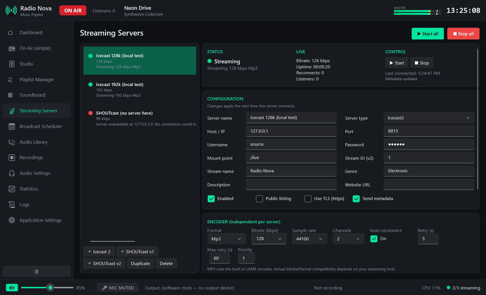
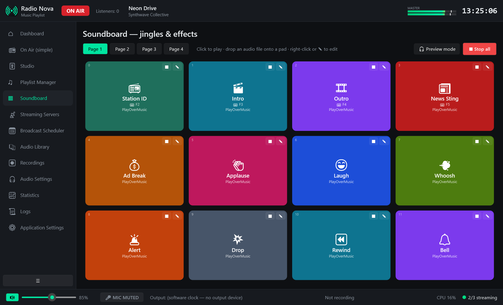
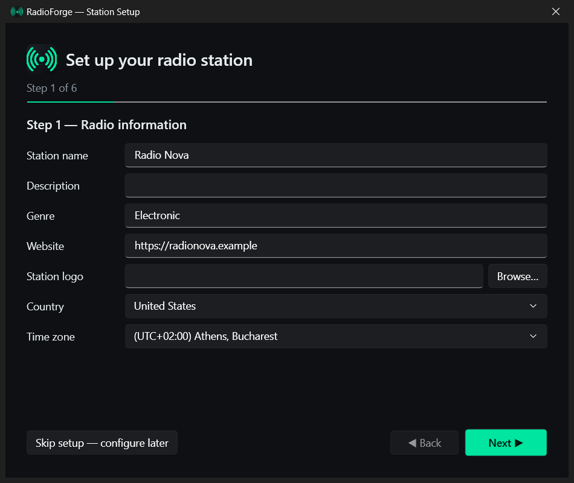

# RadioForge

**A Windows internet-radio broadcasting studio** — live mixing console, Auto DJ, soundboard, scheduler, recording, and **multi-server streaming** (Icecast 2, SHOUTcast v1/v2) with an independent encoder per destination. WPF · .NET 10 · NAudio / WASAPI · SQLite.


## Highlights
* **Multi-destination streaming** — unlimited servers, each with its own codec (MP3 / AAC / Ogg), bitrate, sample rate and channels. Compatible destinations share one encoder; one failing server never interrupts the others. Automatic reconnect with back-off, live bitrate, uptime, per-server logs, **Test connection** diagnostics.
* **Live studio** — Music / Microphone / Effects / Aux / System channels, faders, mute/solo, meters with peak/clip, master limiter, mic chain (gate, compressor, EQ, reverb, echo), push-to-talk, **ducking**, safe-by-default monitoring.
* **Playlists & Auto DJ** — library with tags/artwork/duplicates/missing-file detection, crossfade and gapless hand-over, M3U import/export.
* **Soundboard** — 48 pads, 5 playback modes, hotkeys, drag-and-drop.
* **Scheduler** — week/month calendar, recurring events, priorities, conflict warnings; runs while minimized to the tray.
* **Recording** while streaming — WAV / MP3 / FLAC, master or a single channel.
* **Visualizer** — 8 modes, 24 presets, custom colors/background, fullscreen.
* **Reliability** — audio-device recovery, atomic config saves with rolling backups, structured logging with credential redaction, crash reports, DPAPI-protected passwords, tray operation that never ends a broadcast without asking.

| Studio | Streaming servers |
|---|---|
|  |  |
| **Soundboard** | **Scheduler** |
|  |  |
| **Statistics** | **Setup wizard** |
|  |  |

More pages: [playlists](Documentation/screenshots/playlists.png) · [library](Documentation/screenshots/library.png) · [recordings](Documentation/screenshots/recordings.png) · [audio settings](Documentation/screenshots/audio-settings.png) · [logs](Documentation/screenshots/logs.png) · [settings](Documentation/screenshots/settings.png)

*Screenshots show the real app running with generated demo audio and a local test Icecast server (so listener counts read 0).*

## Install
Download **RadioForge-Setup.exe** from the [Releases](https://github.com/unupunct/RadioForge/releases) page (Windows 10 1809+ / 11, x64; .NET runtime included). See [INSTALLATION.md](Documentation/INSTALLATION.md). The installer is not code-signed, so SmartScreen will warn.

Docs: [user guide](Documentation/README.md) · [streaming setup](Documentation/STREAMING_SETUP.md) · [troubleshooting](Documentation/TROUBLESHOOTING.md)

## Build from source
Requires the .NET 10 SDK (and Inno Setup 6 for the installer).
```powershell
dotnet build Source\RadioForge.sln
dotnet test  Source\RadioForge.Tests
powershell -ExecutionPolicy Bypass -File scripts\build-installer.ps1   # -> Installer\RadioForge-Setup.exe
```
Layout: `Source/RadioForge.Core` (audio engine, streaming, scheduler, storage) · `Source/RadioForge.App` (WPF UI) · `Source/RadioForge.Tests` · `Tools/RadioForge.DevServer` (local test Icecast).

## Verification status (honest)
**Verified** — 74 automated tests pass, including real-TCP integration tests against local servers implementing the Icecast (`PUT`/`SOURCE`) and SHOUTcast source protocols: MP3 streaming with correct headers, different encoders per destination at once, wrong-password / unreachable / bad-mount diagnostics, one failed destination not affecting others, automatic reconnect after a server outage, metadata updates, listener counts, recording while streaming, ducking, soundboard modes, Auto DJ, scheduler execution, config recovery, no passwords in logs/exports, and AAC/Ogg through FFmpeg. A hardware test opens the real WASAPI output and microphone. The published build launches, and the installer was run (silent install → launch → single-instance → uninstall) on the development PC.

**Not verified** — talking to *real* Icecast / SHOUTcast (DNAS) servers or commercial hosts; installation on a clean Windows VM; microphone-ducking with a physical DJ microphone; long-duration (multi-day) soak tests; Windows 10 specifically (developed on Windows 11).

**Known limitations** — SHOUTcast v2 uses the legacy source protocol (the newer framed protocol isn't implemented, because it can't be validated without a real DNAS 2 server); AAC/Ogg streaming and FLAC recording need FFmpeg (one-click download in *Application Settings → Advanced*, or any FFmpeg on your PATH — the one-click download path itself was verified against a local test server, not against GitHub); panels are resizable and the sidebar collapsible but not freely dockable; the installer is not code-signed unless you build it with your own certificate (see below).

## What's new in 1.2
* **Radio sound** — one switch (Studio / Audio Settings): rumble filter, automatic gain control that brings every track to the same level, 3-band compressor and soft safety clipper, then the master limiter. Off / Gentle / Radio / Loud. Plus **loudness normalisation** (ITU BS.1770 LUFS, per-track gain, target adjustable) with *Analyze loudness* in the library.
* **Crossfade and gapless** — equal-power crossfade, or exact gapless hand-over at 0 s; **silence trimming** skips silent intros and hands over early after silent endings. Verified by tests that capture the program output (no gap > 5 ms; loudness dip < 3 dB during a crossfade).
* **Simple mode** — an *On Air* page (big on-air button, now playing, mic, volume, four jingles, setup hints) and a sidebar reduced to five pages.
* **First-run content** — original sample tracks, a sample playlist and four jingles (wizard option or Settings button).
* **Voice tracks** — record a link privately (never on air) and drop it into a playlist after the selected track.
* **Show archiving + podcast feed** — mark a scheduled event *Archive*; it is recorded while on air and listed in `podcast.xml` (set the public URL under Recordings).
* **Stream health alerts** — Discord/Slack-compatible webhook and/or e-mail (SMTP) when a server drops, fails to log in, reconnects or a device is lost (de-duplicated; secrets encrypted).
* **Now-playing web page** — optional mobile-friendly page + `/nowplaying.json` (this PC only, or your network).
* **Polish & quality** — visualizer colors always visible with swatches and reset, country defaults to your region, fuller waterfall; **9 UI tests** that open the real window and check every page for binding errors, blank rendering, accessible names on every interactive control, keyboard shortcuts, buttons, sidebar and simple mode.

## What's new in 1.1
* **System-wide hotkeys** — tick *System-wide* per shortcut (Start/Stop broadcast are on by default; needs Ctrl/Shift/Alt or an F-key). Conflicts with other apps are reported. Verified end to end: hotkeys sent while Notepad had focus started and stopped the broadcast.
* **Accent color** — all native controls (sliders, checkboxes, toggles, selections) now follow the app accent instead of the Windows accent.
* **Panel layout** — drag the dividers in Servers, Playlists and Studio; sizes persist; collapsible sidebar (☰); *Reset panel layout*.
* **FFmpeg download** — one-click install of the LGPL FFmpeg build into your data folder (asks first; ~175 MB).
* **Signing-ready build** — `scripts\build-installer.ps1` signs the app and installer when `RF_SIGN_PFX` / `RF_SIGN_PFX_PASSWORD` are set (signing mechanics verified with a throwaway self-signed certificate; a real trusted certificate — e.g. from a commercial CA, Azure Trusted Signing or SignPath — is still needed to remove the SmartScreen warning for users).

## License
MIT — see [LICENSE](LICENSE). Third-party components (incl. LGPL LAME and TagLibSharp): [THIRD_PARTY_NOTICES.md](THIRD_PARTY_NOTICES.md).
