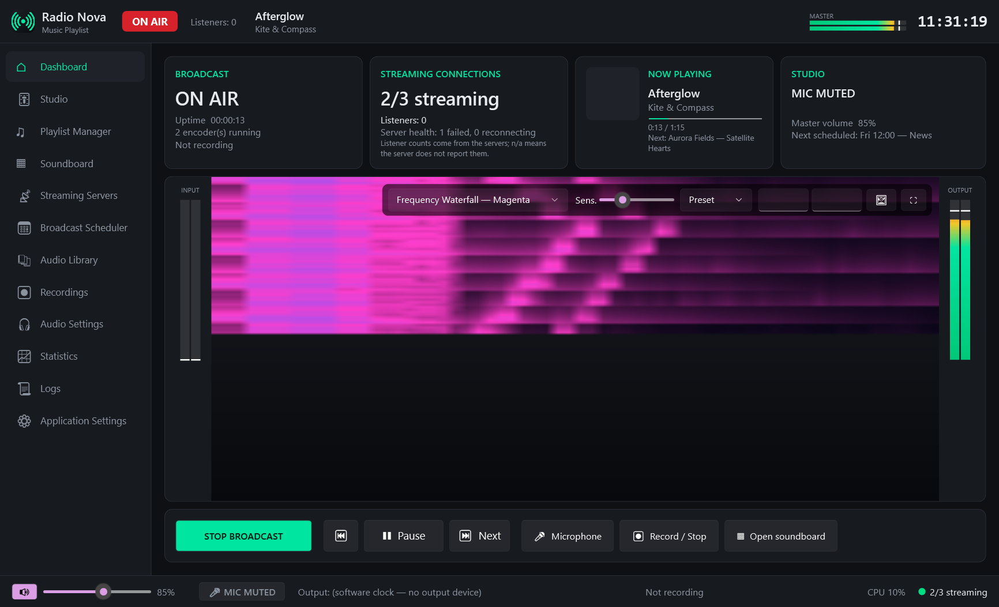
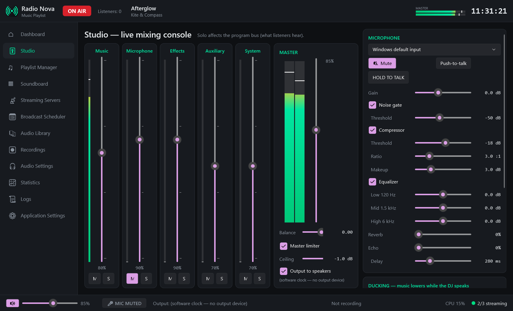
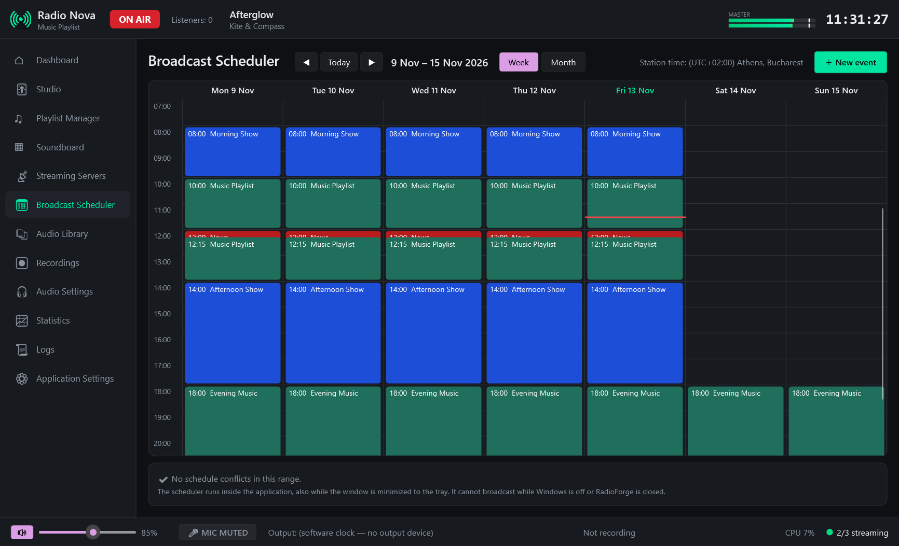
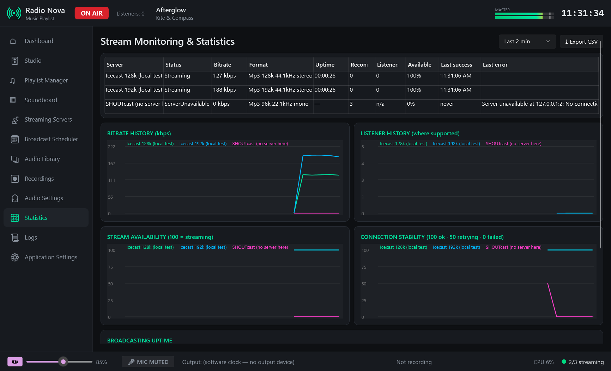

# RadioForge

**A Windows internet-radio broadcasting studio** — live mixing console, Auto DJ, soundboard, scheduler, recording, and **multi-server streaming** (Icecast 2, SHOUTcast v1/v2) with an independent encoder per destination. WPF · .NET 10 · NAudio / WASAPI · SQLite.



## Highlights
* **Multi-destination streaming** — unlimited servers, each with its own codec (MP3 / AAC / Ogg), bitrate, sample rate and channels. Compatible destinations share one encoder; one failing server never interrupts the others. Automatic reconnect with back-off, live bitrate, uptime, per-server logs, **Test connection** diagnostics.
* **Live studio** — Music / Microphone / Effects / Aux / System channels, faders, mute/solo, meters with peak/clip, master limiter, mic chain (gate, compressor, EQ, reverb, echo), push-to-talk, **ducking**, safe-by-default monitoring.
* **Playlists & Auto DJ** — library with tags/artwork/duplicates/missing-file detection, crossfade and gapless hand-over, M3U import/export.
* **Soundboard** — 48 pads, 5 playback modes, hotkeys, drag-and-drop.
* **Scheduler** — week/month calendar, recurring events, priorities, conflict warnings; runs while minimized to the tray.
* **Recording** while streaming — WAV / MP3 / FLAC, master or a single channel.
* **Visualizer** — 8 modes, 24 presets, custom colors/background, fullscreen.
* **Reliability** — audio-device recovery, atomic config saves with rolling backups, structured logging with credential redaction, crash reports, DPAPI-protected passwords, tray operation that never ends a broadcast without asking.

| Studio | Streaming servers |
|---|---|
|  |  |
| **Soundboard** | **Scheduler** |
|  |  |
| **Statistics** | **Setup wizard** |
|  |  |

More pages: [playlists](Documentation/screenshots/playlists.png) · [library](Documentation/screenshots/library.png) · [recordings](Documentation/screenshots/recordings.png) · [audio settings](Documentation/screenshots/audio-settings.png) · [logs](Documentation/screenshots/logs.png) · [settings](Documentation/screenshots/settings.png)

*Screenshots show the real app running with generated demo audio and a local test Icecast server (so listener counts read 0).*

## Install
Download **RadioForge-Setup.exe** from the [Releases](https://github.com/unupunct/RadioForge/releases) page (Windows 10 1809+ / 11, x64; .NET runtime included). See [INSTALLATION.md](Documentation/INSTALLATION.md). The installer is not code-signed, so SmartScreen will warn.

Docs: [user guide](Documentation/README.md) · [streaming setup](Documentation/STREAMING_SETUP.md) · [troubleshooting](Documentation/TROUBLESHOOTING.md)

## Build from source
Requires the .NET 10 SDK (and Inno Setup 6 for the installer).
```powershell
dotnet build Source\RadioForge.sln
dotnet test  Source\RadioForge.Tests
powershell -ExecutionPolicy Bypass -File scripts\build-installer.ps1   # -> Installer\RadioForge-Setup.exe
```
Layout: `Source/RadioForge.Core` (audio engine, streaming, scheduler, storage) · `Source/RadioForge.App` (WPF UI) · `Source/RadioForge.Tests` · `Tools/RadioForge.DevServer` (local test Icecast).

## Verification status (honest)
**Verified** — 48 automated tests pass, including real-TCP integration tests against local servers implementing the Icecast (`PUT`/`SOURCE`) and SHOUTcast source protocols: MP3 streaming with correct headers, different encoders per destination at once, wrong-password / unreachable / bad-mount diagnostics, one failed destination not affecting others, automatic reconnect after a server outage, metadata updates, listener counts, recording while streaming, ducking, soundboard modes, Auto DJ, scheduler execution, config recovery, no passwords in logs/exports, and AAC/Ogg through FFmpeg. A hardware test opens the real WASAPI output and microphone. The published build launches, and the installer was run (silent install → launch → single-instance → uninstall) on the development PC.

**Not verified** — talking to *real* Icecast / SHOUTcast (DNAS) servers or commercial hosts; installation on a clean Windows VM; microphone-ducking with a physical DJ microphone; long-duration (multi-day) soak tests; Windows 10 specifically (developed on Windows 11).

**Known limitations** — SHOUTcast v2 uses the legacy source protocol (the newer framed protocol isn't implemented); shortcuts are in-app only (not global); AAC/Ogg/FLAC need a separately installed FFmpeg; panel re-arrangement is not implemented (windows and panels resize, theme/accent/font scale are configurable).

## License
MIT — see [LICENSE](LICENSE). Third-party components (incl. LGPL LAME and TagLibSharp): [THIRD_PARTY_NOTICES.md](THIRD_PARTY_NOTICES.md).
